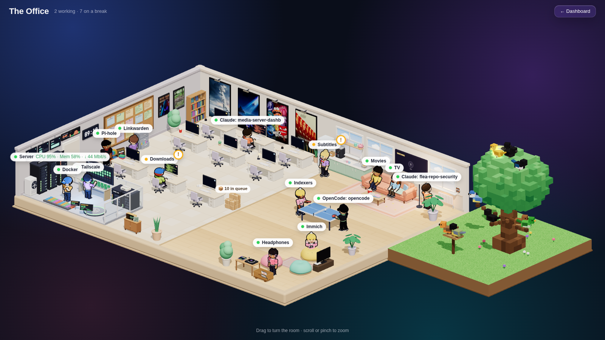
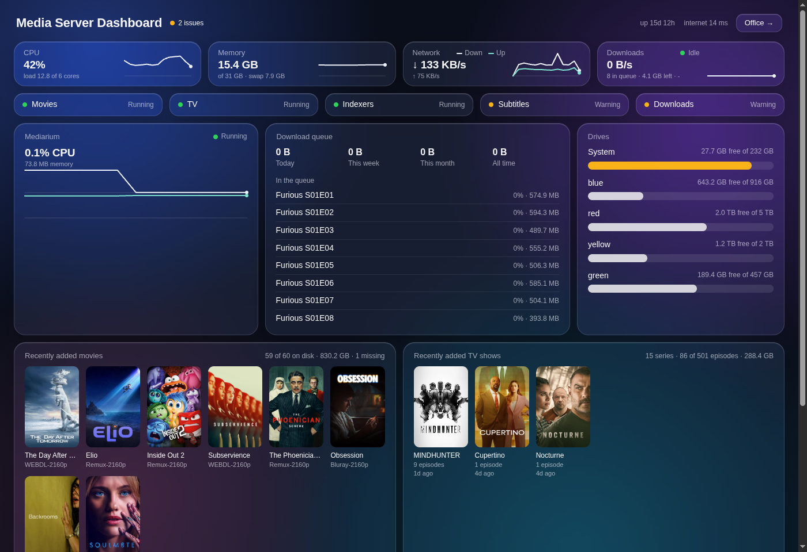
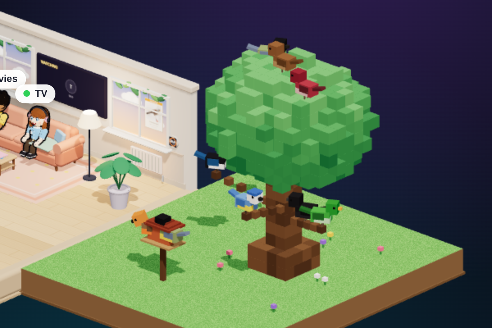
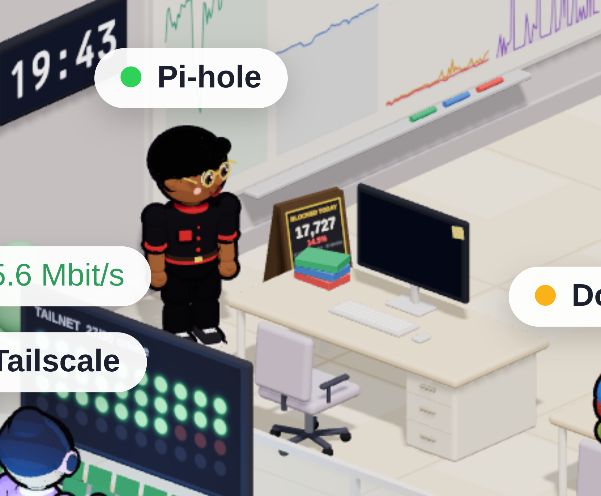
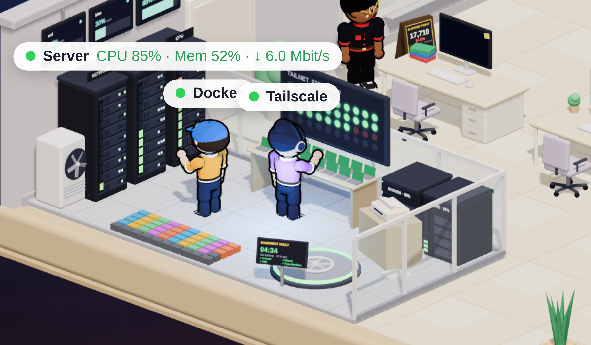
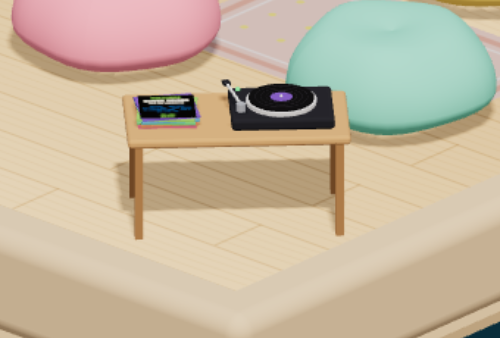
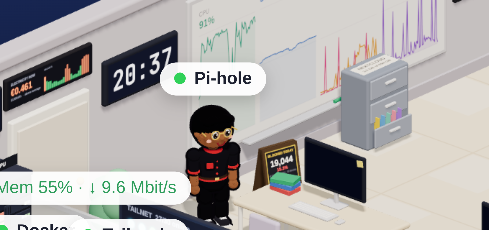
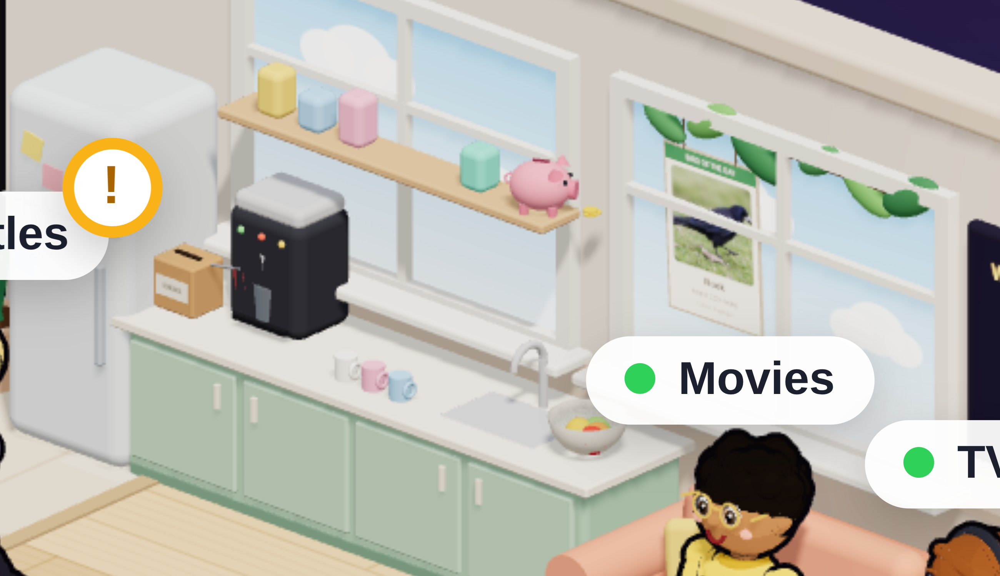

# Media Server Dashboard: Linux + Mediarium edition

A dashboard for your self-hosted media server, plus a tiny 3D office where **your services are the employees**.
This is a fork of [**Essq1337/media-server-dashboard**](https://github.com/Essq1337/media-server-dashboard), ported from a Mac to Linux, pointed at
[Mediarium](https://github.com/rdborg/Mediarium), and extended with more workers, a pixel tree full of the day's birds, and a server room crew.

## A thank-you to the original

Honestly, the original is the reason this exists, and it deserves some praise. Turning "which of my apps are busy?" into a toy office where
Radarr and friends sit at their desks while they work and wander off to the break room when there's nothing to do is a lovely idea: you can read
the health of a whole server at a glance, from across the room, without reading a single number. The execution is just as good:

- the **look**: soft rounded blocks, warm wood floors, little people with real personalities, a ping-pong rally in the break room. It feels like a
  toy, not a monitoring tool, and that is exactly why you actually want to keep it open;
- the **details**: parcels pile up as the download queue grows, the newest movies hang on the wall as framed posters, the data-center racks light
  up with CPU, memory, network and drive use;
- the **restraint**: standard-library Python, one vendored copy of three.js, no accounts, no analytics, nothing phoning home.

Everything below is built on that foundation. If you like this, go give the original a star.

## What this fork changes

**Ported to Linux.** System stats come from `/proc` instead of macOS tools (`iostat`, `vm_stat`, `netstat`, `pmset`), and a **systemd user service**
replaces the launchd agent (`./install.sh` / `./uninstall.sh`).

**Reads from Mediarium instead of five separate apps.** [Mediarium](https://github.com/rdborg/Mediarium) does the jobs of Radarr, Sonarr, Prowlarr,
SABnzbd and Bazarr in one app, so the five office workers are now the five *jobs* it does: **Movies, TV, Downloads, Subtitles, Indexers**. The
dashboard only makes read-only calls to Mediarium's HTTP API. Mediarium reports progress but not speed, so the download speed is worked out from
how much more got done between two readings.

The dashboard page keeps the original's layout and adds a card with Mediarium's own CPU and memory, read from the container.

**Hardened.** The server listens only on the addresses you list in `config.json` (for example localhost plus a Tailscale address), the login now
applies to localhost too, the session cookie lasts 30 days instead of a year, and the poster proxy refuses redirects. The Home Cinema integration
(the author's own player) is gone. The Mac mini model is gone too: the racks stand for the machine.

## What this fork adds

### A framework for adding more services

Every extra service is **one small Python file in `sources/`** (it polls the service and returns a dict) and **one JavaScript module in
`office_props/`** (it draws that data in the room). The server loads whatever it finds, polls each source on its own thread, serves images through an
authenticated `/media/<source>/` proxy with strict input checks, and keeps credentials in `secrets/<name>` files (mode 600, never committed).
See [`sources/README.md`](sources/README.md). The props get a little kit of helpers (rounded boxes, canvas textures, standing characters, hover text).

### The real sky in the windows

The windows show **the real sky**: it follows the sun's actual position over your location (stars at night, golden hour in the evening). Set
`"location": {"lat": .., "lon": ..}` in `config.json`, and add `?hour=21` to the office address to preview another time of day.

### A pixel tree with a bird feeder

If you run [BirdNET-Go](https://github.com/tphakala/birdnet-go), a tree made of cubes stands outside the right edge of the office, with an open bird feeder platform in front of it. The nine busiest species of the day sit in it as little
pixel birds, the two busiest at the feeder, the rest on the branches and on top of the leaves. Each species gets its own colours (robin, blue tit, great tit,
blackbird, sparrow, magpie, finches, starling, crows and a few more, in English and Dutch; anything else gets a colour made from its name). They preen, peck
at the feeder and hop around, and the bird that was heard most recently hops. Hover one for its name and count; double-click opens BirdNET-Go.
A **rare visitor** (BirdNET-Go's own *new species* or *infrequent species* alert from the last week) is a **gold bird** with a soft glow, in the
tree even when it is not among today's busiest.

### The Pi-hole bouncer

[Pi-hole](https://pi-hole.net) (v6) is a guard in a black suit who stands by the door. A sandwich board beside him shows what he turned away in the
last 24 hours: the count, the percentage, how many devices asked, and the five most-blocked domains. Hover him for the details; he looks different
when blocking is paused.

### The server room crew

None of these need credentials; they read local state only.

- **Docker engineer**: one little crate in the yard per container (coloured when running, grey when stopped, red when unhealthy). He gets busy for a
  few minutes whenever something starts, stops or restarts, and checks his clipboard when all is quiet.
- **Tailscale switchboard operator**: a board of lights, one per device on your tailnet (green online, cyan talking right now, dark offline), and a desk
  of little laptops and phones for the devices that are on.
- **Cloudflared fax machine**: sits on the two small drive racks and prints a page whenever the tunnel handles a request; the light turns red if the tunnel is down.
- **Backup vault**: a hatch in the floor ("the basement") with a screen showing when the last backup ran and each job's result. The ring glows green,
  or red when any job has failed. It reads your backup jobs' systemd units.

### The record player (Navidrome)

A little table on the left edge of the beanbag corner (so you look at it from behind) holds a turntable and a stack of the albums you played lately, with the newest
cover on top. The record spins while something is playing; hover the stack for the track, the artist and the last few albums. It reads
[Navidrome](https://www.navidrome.org)'s own database **read-only**, so it needs no login or API key, and it finds cover art next to the music files or
inside them (read through `ffmpeg` into memory; nothing is written to disk).

### The gaming nook (Sunshine)

On the right edge of the beanbag corner a TV on a low cabinet and a game console wait for a stream from [Sunshine](https://github.com/LizardByte/Sunshine)
(the game-streaming host you use with Moonlight). It sleeps on a "ready" screen and wakes up when someone streams: the screen shows what is
streaming, to which device and for how long, and the console light pulses. Hover it for the paired devices and how often you streamed this week.
It reads Sunshine's own log, read-only and without a login, so there is no worker for it: the room just lights up when it is in use.

### Headphones, Linkwarden and podcasts

- **Headphones** (the music downloader): a **record crate** beside the record player, with a sleeve for every album that arrived lately (the newest
  leans forward showing its cover). A **DJ with headphones** looks after it, flips through the crate while an album is on its way, and nods along
  while the record player plays. Hover for what is downloaded, arriving and wanted. Read from Headphones' own database, no API key.
- **Linkwarden** (bookmarks): a **cork pinboard** on the left wall with a sticky note for each of the newest saved links. When a new link is saved,
  from the web app or from your phone, a **librarian** walks to the board and pins a note, then walks back to his book cart. Hover for the latest titles.
- **Opodsync** (podcast sync): a **radio on a cabinet** at the front edge, with the cover of the podcast episode your apps played last standing next
  to it. The display shows the podcast, the episode, how far you got and how long ago; the ON AIR light and floating notes are on while something was
  played in the last twenty minutes. The episode title and cover come from the podcast's own public feed, which the dashboard fetches (at most once an hour).

### More of your home in the room

- **Jellyfin**: the "WATCHING" TV above the couch has a circle per user that lights up while they watch; hover it to see what is playing.
- **Immich**: the two small wall frames show random photos from your library (swapped every couple of minutes; only logged-in viewers can see
  them), and a **photographer** with a camera sits at a desk while Immich has uploads or machine learning jobs to work through.
- **Home Assistant**: a **thermostat and radiator** under the right window (the radiator glows while the house is heating), an **electricity
  price ticker** above the door (price now, and the next 24 hours as bars, green below average), and the **office lamps follow your living room
  lights**: the same colour and brightness, fading smoothly.
- **Nextcloud**: a **filing cabinet** whose top drawer opens further as the storage fills.
- **BookOrbit**: a **bookshelf** with the three newest books standing face-out.
- **FreshRSS**: a **stack of newspapers** on the coffee table, one more sheet for every few hundred unread articles.
- **Seerr**: a **suggestion box** on the kitchen counter; the flag goes up and a slip of paper appears for every request waiting for a yes.
- **Spaarpot** (a small savings-wish-list app): a **piggy bank** on the kitchen shelf with a coin per wish; hover for the list.

### Coding agents (Claude Code and OpenCode)

Every running **Claude Code** session and **OpenCode** instance is a worker too, in a different outfit so they stand out: Claude in a terracotta
jumpsuit with a glowing antenna that pulses while it works, OpenCode in a dark suit with a neon visor. They have three desks along the back wall.
A working agent sits and types; an idle one takes a break like everyone else.

When an agent **needs you** (Claude Code is waiting for an approval or an answer), a **red light blinks on its desk**, the agent raises a hand and
waves, and its label gets the usual "!" badge. This reads the status file each Claude Code session already keeps in `~/.claude/sessions`, so no
hooks or settings are touched. OpenCode agents ask for attention too: the source asks OpenCode's own local server whether a session is working,
or has an approval or a question waiting (it needs the password OpenCode keeps in `~/.local/state/opencode/service.json`; it is read at every poll,
only sent to a loopback address, and only GET requests are made; set `"opencode_api": false` for the `agents` source to turn this off). The idea
of a character that gets your attention comes from [clalt](https://github.com/dhitalkamal/clalt), which draws Claude agents in a 3D office of its own. Session names are only
shown to logged-in viewers.

### Double-click to open

Double-click almost anything in the office to open its service in a new tab: a worker or the parcel pile or a wall poster opens Mediarium, the
bouncer opens Pi-hole, the filing cabinet opens Nextcloud, and so on. Hover text says "double-click to open" where it works. (A double-click, not
a single click, so turning the room never opens a tab by accident.) Set the addresses your browser can reach in `config.json`, as `"open"` in each
source and `"mediarium_open"` for Mediarium; items without one simply do nothing.

An item can also start a **desktop app** instead: the record player brings NaviBeat to the front (or starts it) when you double-click it while sitting
at this computer, and opens the Navidrome web page when you are looking from another device. The page only sends the app's name; the command lives in
`config.json` (`"launch"` plus `"launch": "<name>"` on the source), the request needs your login, and it is only honoured for a viewer on this
machine. It talks to Hyprland (`hyprctl`) to focus or start the window.

### Idle workers wander

Workers who aren't busy no longer park in one spot: they stroll along the walkways between the couch, the coffee machine, the ping-pong table (a
rally starts when two of them meet), the bean bag, the window (bird-watching) and the record player, and head back to their desk when there is work.
Nobody shares a spot, and everyone stays a while before moving on.

## Setup

1. In Mediarium make an API key (Profile, then API keys) and save it as one line in `mediarium_api_key`, mode 600 (it is in `.gitignore`).
   A key acts as the account that made it, so prefer an account with only the access you want the dashboard to have.
2. `cp config.example.json config.json` and set `bind` (for tailnet-only access use the address from `tailscale ip -4`).
3. Optional sources read their address and credentials from `config.json` and `secrets/`:

   | Source | Needs |
   |---|---|
   | BirdNET-Go | its address (default `http://birdnet-go.local:8080`), no login |
   | Pi-hole v6 | its address, and its password in `secrets/pihole_password` |
   | Navidrome | the path of its `navidrome.db` and the folder its music library points to, no login |
   | Jellyfin | its address and an API key in `secrets/jellyfin_key` |
   | Immich | its address and an API key in `secrets/immich_key` (read permissions: assets, server statistics, jobs) |
   | Home Assistant | its address, a long-lived token in `secrets/ha_token`, and the entity ids to show (see `config.example.json`) |
   | Seerr | its address and its API key in `secrets/seerr_key` |
   | Nextcloud, FreshRSS, BookOrbit | the Docker container names; they are read with `docker exec`, no login |
   | Linkwarden | the name of its Postgres container (read with `docker exec`, a plain select, no token) |
   | Headphones, Opodsync | the path of their database files (SQLite, read-only) |
   | Spaarpot | the path of its SQLite file |
   | Docker, Tailscale, Cloudflared, backups | nothing (see `config.example.json` for overrides) |

   Remove a source you don't use by deleting its file or listing it in `"sources_off"`.
4. `./install.sh`, then open `http://<bind address>:8900`. The password is in `password.txt`, created on first run.
5. If you use ufw, allow the port for your tailnet only, e.g. `sudo ufw allow in on tailscale0 to any port 8900 proto tcp`.

`python3 server.py --demo` still runs with made-up data (it predates the new sources, so the windows, bouncer and server room crew stay empty there).

## Privacy and safety

- Everything is read-only: the dashboard only sends GET requests to the services it watches (plus the logins Pi-hole and Mediarium require).
- API keys and passwords are read on the server and never sent to the browser. `config.json`, `password.txt`, `.secret`, `mediarium_api_key`,
  `secrets/`, `stats.json` and logs are all in `.gitignore`.
- The Opodsync radio makes the server fetch the public feed and cover image of the podcast you played last (only real web addresses, never
  anything on your own network).
- The browser loads poster images from TMDB/TheTVDB; bird photos and everything else are fetched by the server. There is one ping to 1.1.1.1 every 30
  seconds for the "internet" indicator.
- Only expose it on a private network (localhost, Tailscale, a LAN). It has a login, but it speaks plain HTTP.

## Adding your own worker

1. Copy `sources/pihole.py` as a starting point: set `NAME` and `EVERY`, and have `poll(ctx)` return a dict with `"ok": true`.
2. Copy `office_props/bouncer.js`: `kit.spawn(...)` creates a standing character, `kit.tipOn(...)` adds hover text, and `update(d)` receives
   `d.extra.<name>` every couple of seconds.
3. Restart the service. If you built something fun, tell the original author about it too.

## Credits and license

[Essq1337/media-server-dashboard](https://github.com/Essq1337/media-server-dashboard) is the original, MIT licensed (see `LICENSE`); this fork keeps
that license. [three.js](https://threejs.org) r160 (MIT) is bundled in `vendor/`. Built with a lot of help from [Claude Code](https://claude.com/claude-code).
