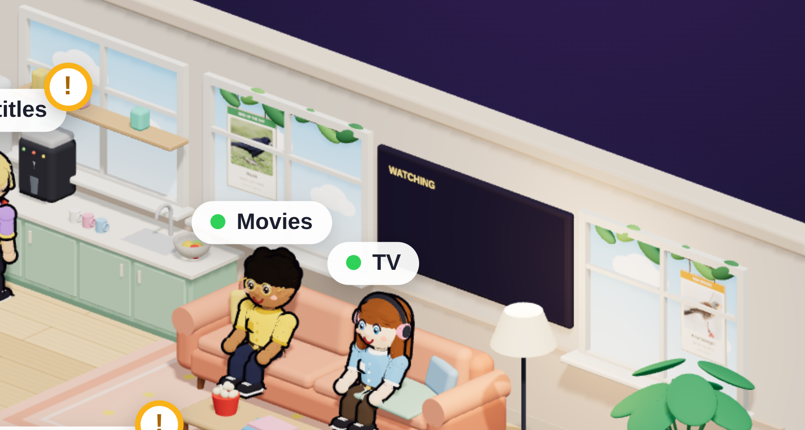
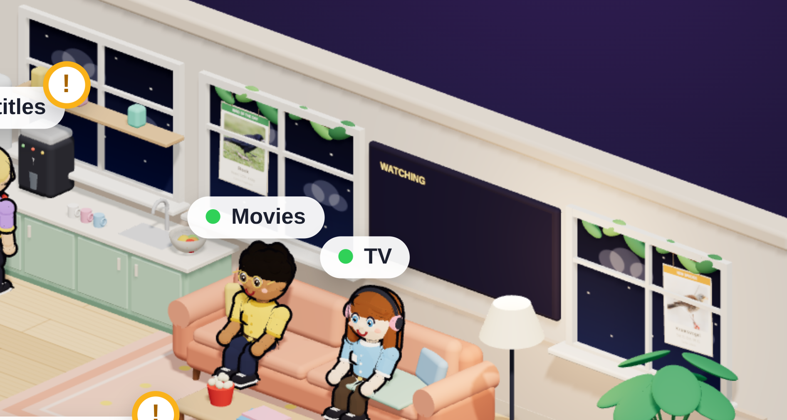

# Media Server Dashboard: Linux + Mediarium edition

A dashboard for your self-hosted media server, plus a tiny 3D office where **your services are the employees**.
This is a fork of [**Essq1337/media-server-dashboard**](https://github.com/Essq1337/media-server-dashboard), ported from a Mac to Linux, pointed at
[Mediarium](https://github.com/rdborg/Mediarium), and extended with more workers, windows with real birds in them, and a server room crew.

## A thank-you to the original

Honestly, the original is the reason this exists, and it deserves some praise. Turning "which of my apps are busy?" into a toy office where
Radarr and friends sit at their desks while they work and wander off to the break room when there's nothing to do is a lovely idea: you can read
the health of a whole server at a glance, from across the room, without reading a single number. The execution is just as good:

- the **look**: soft rounded blocks, warm wood floors, little people with real personalities, a ping-pong rally in the break room. It feels like a
  toy, not a monitoring tool, and that is exactly why you actually want to keep it open;
- the **details**: parcels pile up as the download queue grows, the newest movies hang on the wall as framed posters, the data-center racks light
  up with CPU, memory, network and drive use, and the whiteboard draws live graphs;
- the **restraint**: standard-library Python, one vendored copy of three.js, no accounts, no analytics, nothing phoning home.

Everything below is built on that foundation. If you like this, go give the original a star.

## What this fork changes

**Ported to Linux.** System stats come from `/proc` instead of macOS tools (`iostat`, `vm_stat`, `netstat`, `pmset`), and a **systemd user service**
replaces the launchd agent (`./install.sh` / `./uninstall.sh`).

**Reads from Mediarium instead of five separate apps.** [Mediarium](https://github.com/rdborg/Mediarium) does the jobs of Radarr, Sonarr, Prowlarr,
SABnzbd and Bazarr in one app, so the five office workers are now the five *jobs* it does: **Movies, TV, Downloads, Subtitles, Indexers**. The
dashboard only makes read-only calls to Mediarium's HTTP API. Mediarium reports progress but not speed, so the download speed is worked out from
how much more got done between two readings.

The dashboard page keeps the original's layout and adds a card with Mediarium's own CPU and memory, read from the container.

**Hardened.** The server listens only on the addresses you list in `config.json` (for example localhost plus a Tailscale address), the login now
applies to localhost too, the session cookie lasts 30 days instead of a year, and the poster proxy refuses redirects. The Home Cinema integration
(the author's own player) is gone. The Mac mini model is gone too: the racks stand for the machine.

## What this fork adds

### A framework for adding more services

Every extra service is **one small Python file in `sources/`** (it polls the service and returns a dict) and **one JavaScript module in
`office_props/`** (it draws that data in the room). The server loads whatever it finds, polls each source on its own thread, serves images through an
authenticated `/media/<source>/` proxy with strict input checks, and keeps credentials in `secrets/<name>` files (mode 600, never committed).
See [`sources/README.md`](sources/README.md). The props get a little kit of helpers (rounded boxes, canvas textures, standing characters, hover text).

### Birds in the windows (BirdNET-Go)

If you run [BirdNET-Go](https://github.com/tphakala/birdnet-go), two windows get a view:

- the **bird of the day** is the species with the most detections since midnight;
- the **newest rare bird of the week** is whatever BirdNET-Go's own *new species* or *infrequent species* alert fired for last, so the window and your
  alerts always agree.

Each is a real photo card hanging from a branch and swaying in the breeze; hover for the details. The photos are fetched by the dashboard, so phones
that can't resolve your Pi's hostname still see them. The windows also show **the real sky**: it follows the sun's actual position over your
location (stars at night, golden hour in the evening). Add `?hour=21` to the office address to preview another time of day.

### The Pi-hole bouncer

[Pi-hole](https://pi-hole.net) (v6) is a guard in a black suit who stands by the door. A sandwich board beside him shows what he turned away in the
last 24 hours: the count, the percentage, how many devices asked, and the five most-blocked domains. Hover him for the details; he looks different
when blocking is paused.

### The server room crew

None of these need credentials; they read local state only.

- **Docker engineer**: one little crate in the yard per container (coloured when running, grey when stopped, red when unhealthy). He gets busy for a
  few minutes whenever something starts, stops or restarts, and checks his clipboard when all is quiet.
- **Tailscale switchboard operator**: a board of lights, one per device on your tailnet (green online, cyan talking right now, dark offline), and a desk
  of little laptops and phones for the devices that are on.
- **Cloudflared fax machine**: prints a page whenever the tunnel handles a request; the light turns red if the tunnel is down.
- **Backup vault**: a hatch in the floor ("the basement") with a screen showing when the last backup ran and each job's result. The ring glows green,
  or red when any job has failed. It reads your backup jobs' systemd units.

## Setup

1. In Mediarium make an API key (Profile, then API keys) and save it as one line in `mediarium_api_key`, mode 600 (it is in `.gitignore`).
   A key acts as the account that made it, so prefer an account with only the access you want the dashboard to have.
2. `cp config.example.json config.json` and set `bind` (for tailnet-only access use the address from `tailscale ip -4`).
3. Optional sources read their address and credentials from `config.json` and `secrets/`:

   | Source | Needs |
   |---|---|
   | BirdNET-Go | its address (default `http://localhost:8080`), no login |
   | Pi-hole v6 | its address, and its password in `secrets/pihole_password` |
   | Docker, Tailscale, Cloudflared, backups | nothing (see `config.example.json` for overrides) |

   Remove a source you don't use by deleting its file or listing it in `"sources_off"`.
4. `./install.sh`, then open `http://<bind address>:8900`. The password is in `password.txt`, created on first run.
5. If you use ufw, allow the port for your tailnet only, e.g. `sudo ufw allow in on tailscale0 to any port 8900 proto tcp`.

`python3 server.py --demo` still runs with made-up data (it predates the new sources, so the windows, bouncer and server room crew stay empty there).

## Privacy and safety

- Everything is read-only: the dashboard only sends GET requests to the services it watches (plus the logins Pi-hole and Mediarium require).
- API keys and passwords are read on the server and never sent to the browser. `config.json`, `password.txt`, `.secret`, `mediarium_api_key`,
  `secrets/`, `stats.json` and logs are all in `.gitignore`.
- The browser loads poster images from TMDB/TheTVDB; bird photos and everything else are fetched by the server. There is one ping to 1.1.1.1 every 30
  seconds for the "internet" indicator.
- Only expose it on a private network (localhost, Tailscale, a LAN). It has a login, but it speaks plain HTTP.

## Adding your own worker

1. Copy `sources/pihole.py` as a starting point: set `NAME` and `EVERY`, and have `poll(ctx)` return a dict with `"ok": true`.
2. Copy `office_props/bouncer.js`: `kit.spawn(...)` creates a standing character, `kit.tipOn(...)` adds hover text, and `update(d)` receives
   `d.extra.<name>` every couple of seconds.
3. Restart the service. If you built something fun, tell the original author about it too.

## Credits and license

[Essq1337/media-server-dashboard](https://github.com/Essq1337/media-server-dashboard) is the original, MIT licensed (see `LICENSE`); this fork keeps
that license. [three.js](https://threejs.org) r160 (MIT) is bundled in `vendor/`. Built with a lot of help from [Claude Code](https://claude.com/claude-code).
